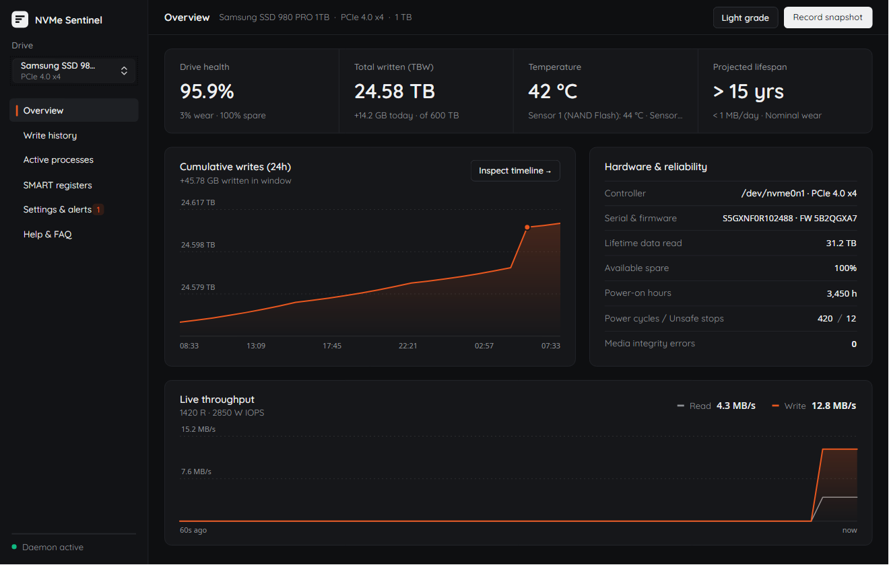
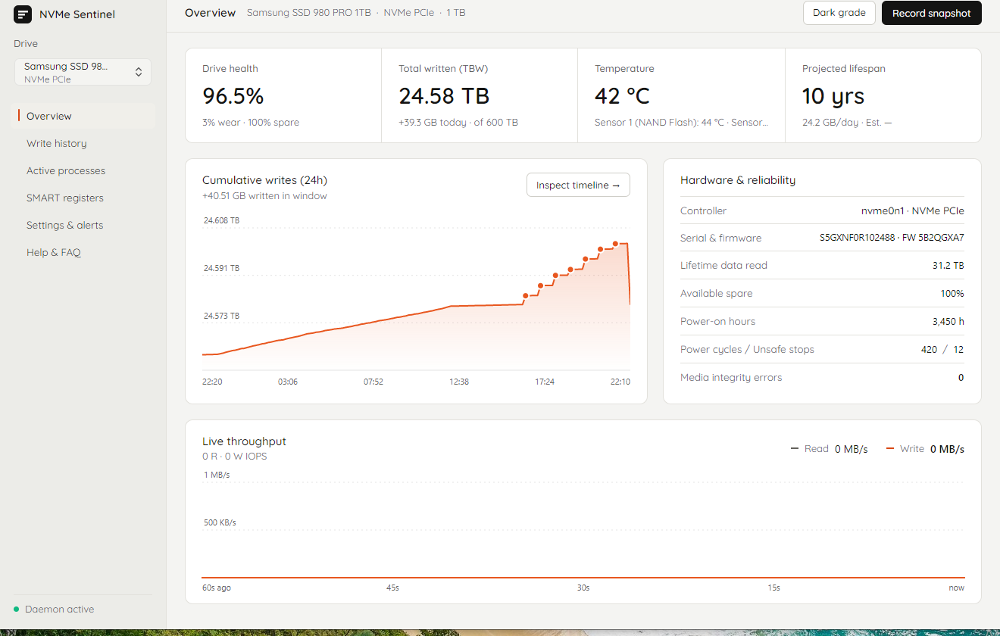
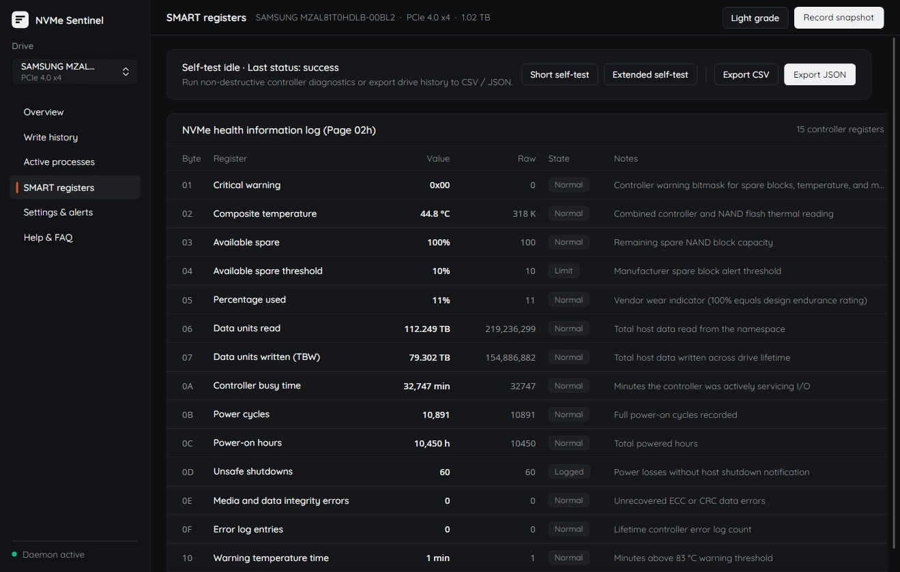
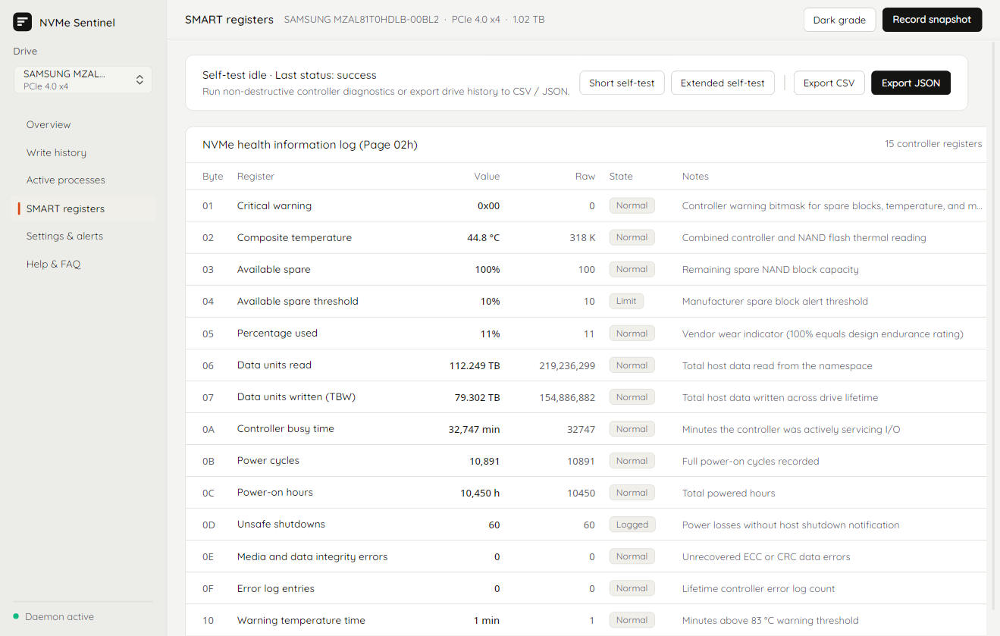

# NVMe Sentinel

[](https://github.com/khoipm06/nvme-sentinel/releases)
[](https://github.com/khoipm06/nvme-sentinel/actions/workflows/ci.yml)
[](LICENSE)
[](#installation)
[](https://dotnet.microsoft.com/)

NVMe Sentinel is a lightweight, cross-platform desktop application and background service that monitors NVMe SSD health, tracks write endurance (TBW), and identifies which running processes write data to your drive over time.

Runs on **Linux**, **Windows**, and **macOS**.

---

## Screenshots

<p align="center">
  <em>Dashboard — Dark Theme</em><br/>
  
</p>

<p align="center">
  <em>Dashboard — Light Theme</em><br/>
  
</p>

<details>
  <summary><b>Hardware Diagnostics & SMART Register Views</b></summary>
  <br/>

  <p align="center">
    <em>Controller SMART Registers & Hardware Diagnostics (Dark Theme)</em><br/>
    
  </p>

  <p align="center">
    <em>Controller SMART Registers & Hardware Diagnostics (Light Theme)</em><br/>
    
  </p>
</details>

---

## Features

- **Process write attribution**: Select any time interval on the timeline to see which processes wrote to your disk and how much each contributed.
- **Low-wear metrics collection**: Samples disk counters, throughput, IOPS, and temperatures in RAM every second, flushing consolidated history to a local SQLite database once every 10 minutes to avoid adding SSD wear.
- **Endurance & lifespan projections**: Tracks daily write burn rates against factory endurance ratings (TBW) to estimate remaining drive lifespan.
- **Configurable alert profiles**: Choose an alert profile matching your workload (Office, Gaming, Workstation, or DWPD-calculated) with sustained spike detection to filter out one-off large file downloads.
- **Live hardware diagnostics**: Real-time read/write throughput, IOPS, PCIe generation/width verification, controller self-tests (Short and Extended), and multi-sensor thermals.
- **In-app documentation**: Built-in Help & FAQ tab answering common questions about write amplification, OEM reboot power cuts, and wear leveling.

---

## Installation

Pre-built binaries are available on the [Releases](https://github.com/khoipm06/nvme-sentinel/releases) page for each platform.

### Windows (10 / 11 x64)

- **Native Installer (Recommended)**:
  Download and run `nvme-sentinel-v1.4.0-win-x64-setup.exe`.
  - Installs to `%LocalAppData%\Programs\NVMe Sentinel` without requiring administrator privileges.
  - Adds Start Menu and Desktop shortcuts.
  - Registers a clean uninstaller in Windows Settings (*Installed apps*).
  - Optional autostart at user login.
- **Portable**:
  Download `nvme-sentinel-v1.4.0-win-x64-standalone.zip`, extract anywhere, and launch `nvme-sentinel.exe`.

### Linux

- **Debian / Ubuntu / Mint (`.deb`)**:
  ```bash
  sudo apt install ./nvme-sentinel_1.4.0_amd64.deb
  systemctl --user enable --now nvme-sentinel
  ```

- **Fedora / RHEL / openSUSE (`.rpm`)**:
  ```bash
  sudo dnf install ./nvme-sentinel-1.4.0-1.x86_64.rpm
  systemctl --user enable --now nvme-sentinel
  ```

- **Other distributions (User-space tarball)**:
  Download `nvme-sentinel-v1.4.0-linux-x64-standalone.tar.gz`, extract, and run:
  ```bash
  tar -xzf nvme-sentinel-v1.4.0-linux-x64-standalone.tar.gz
  cd nvme-sentinel-v1.4.0-linux-x64-standalone
  ./install.sh
  ```
  To uninstall later, run `~/.local/share/nvme-sentinel/uninstall.sh`.

### macOS

- **Native Disk Image (`.dmg`)**:
  1. Download the disk image for your Mac architecture:
     - Apple Silicon (M1–M4): `NVMe-Sentinel-v1.4.0-osx-arm64.dmg`
     - Intel: `NVMe-Sentinel-v1.4.0-osx-x64.dmg`
  2. Double-click the `.dmg` file and drag **NVMe Sentinel.app** into your **Applications** folder.
  3. **First launch**: Because NVMe Sentinel is open-source software distributed outside the Mac App Store:
     - Open **Finder** and navigate to **Applications**.
     - **Control-click** (or right-click) **NVMe Sentinel** and choose **Open**.
     - In the confirmation prompt, click **Open**. (You only need to do this once).
     - *If macOS shows a warning instead:* Open **System Settings** > **Privacy & Security**, scroll down to the **Security** section, and click **Open Anyway**.
  4. **Start at login (optional)**:
     - Open **System Settings** > **General** > **Login Items**.
     - Under **Open at Login**, click the **+** button and select **NVMe Sentinel** from your Applications folder.

- **Standalone Archive (`.tar.gz`)**:
  If you prefer a terminal workflow or want to deploy headlessly, download the `.tar.gz` archive, extract it, and run `./install.sh`. This sets up the binary, registers a user `LaunchAgent` service, and links CLI commands to your path. To remove it later, run `uninstall.sh`.

---

## Daemon & CLI Usage

The background service (`nvme-sentinel-daemon`) runs quietly in the background and communicates with the desktop app over a local IPC socket. It can also be called directly from the command line:

```bash
# Print current hardware snapshot as JSON
nvme-sentinel-daemon --status

# Output status formatted for Waybar or Polybar
nvme-sentinel-daemon --waybar

# Export historical telemetry to a file (CSV or JSON)
nvme-sentinel-daemon --export /path/to/report.csv
nvme-sentinel-daemon --export /path/to/report.json

# Gracefully stop the background daemon
nvme-sentinel-daemon --stop
```

### Waybar Configuration Example

```json
"custom/nvme": {
    "exec": "nvme-sentinel-daemon --waybar",
    "return-type": "json",
    "interval": 2,
    "format": "SSD {text}"
}
```

---

## Building from Source

Requirements: [.NET 10 SDK](https://dotnet.microsoft.com/)

```bash
git clone https://github.com/khoipm06/nvme-sentinel.git
cd nvme-sentinel

# Build Release binaries
dotnet build NvmeSentinel.sln -c Release

# Run test suite
dotnet test

# Launch GUI app
./scripts/run-gui.sh
```

---

## License

Distributed under the [MIT License](LICENSE).
