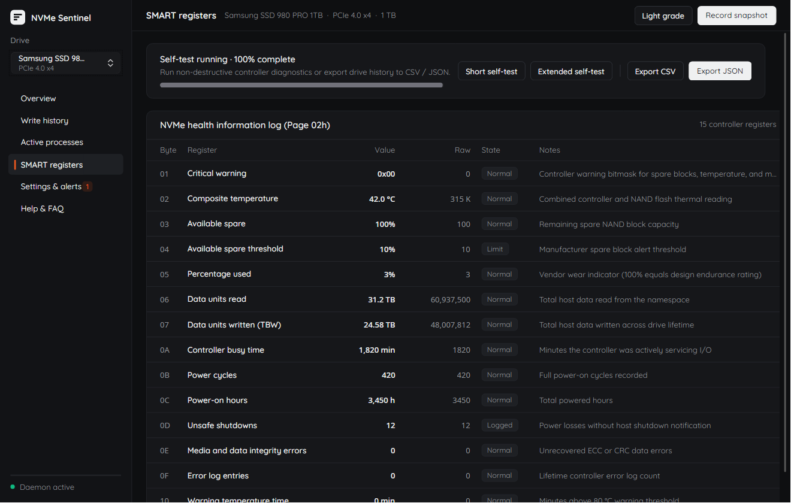
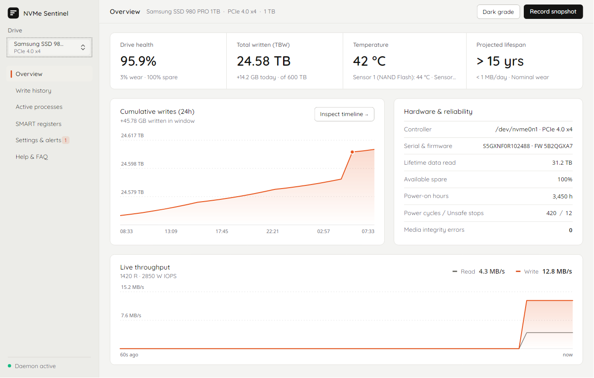

# NVMe Sentinel

[](https://github.com/khoipm06/nvme-sentinel/releases)
[](https://github.com/khoipm06/nvme-sentinel/actions)
[](LICENSE)
[](#installation)
[](https://dotnet.microsoft.com/)

NVMe Sentinel is a cross-platform desktop application and background service that monitors NVMe SSD health, tracks write endurance (TBW), and identifies which running processes write data to your drive over time.

Runs on **Linux**, **Windows**, and **macOS**.

---

## Screenshots

<p align="center">
  
</p>

<details>
  <summary><b>Additional views (SMART Diagnostics & Light Theme)</b></summary>
  <br/>

  <p align="center">
    <em>Controller SMART Registers & Hardware Diagnostics</em><br/>
    
  </p>

  <p align="center">
    <em>Dashboard (Light Theme)</em><br/>
    
  </p>
</details>

---

## Features

- **Process write attribution**: Select any time interval on the timeline to see which processes wrote to your disk and how much each contributed.
- **Low-wear metrics collection**: Samples disk counters, throughput, IOPS, and temperatures in RAM every second, flushing consolidated history to a local SQLite database once every 10 minutes to avoid adding SSD wear.
- **Endurance & lifespan projections**: Tracks daily write burn rates against factory endurance ratings (TBW) to estimate remaining drive lifespan.
- **Configurable alert profiles**: Choose an alert profile matching your workload (Office, Gaming, Workstation, or DWPD-calculated) with sustained spike detection to filter out one-off large file downloads.
- **Live hardware diagnostics**: Real-time read/write throughput, IOPS, PCIe generation/width verification, controller self-tests (Short and Extended), and multi-sensor thermals.
- **Desktop status bar & CLI export**: Integration for Waybar/Polybar via `--waybar`, plus terminal telemetry exports to CSV or JSON.
- **In-app documentation**: Built-in Help & FAQ tab answering common questions about write amplification, OEM reboot power cuts, and wear leveling.

---

## Installation

Pre-built binaries are available on the [Releases](https://github.com/khoipm06/nvme-sentinel/releases) page for each platform.

### Windows (10 / 11 x64)

- **Native Installer (Recommended)**:
  Download and run `nvme-sentinel-v1.3.2-win-x64-setup.exe`.
  - Installs to `%LocalAppData%\Programs\NVMe Sentinel` without requiring administrator privileges.
  - Adds Start Menu and Desktop shortcuts.
  - Registers a clean uninstaller in Windows Settings (*Installed apps*).
  - Optional autostart at user login.
- **Portable**:
  Download `nvme-sentinel-v1.3.2-win-x64-standalone.zip`, extract anywhere, and launch `nvme-sentinel.exe`.

### Linux

- **Debian / Ubuntu / Mint (`.deb`)**:
  ```bash
  sudo apt install ./nvme-sentinel_1.3.2_amd64.deb
  systemctl --user enable --now nvme-sentinel
  ```

- **Fedora / RHEL / openSUSE (`.rpm`)**:
  ```bash
  sudo dnf install ./nvme-sentinel-1.3.2-1.x86_64.rpm
  systemctl --user enable --now nvme-sentinel
  ```

- **Other distributions (User-space tarball)**:
  Download `nvme-sentinel-v1.3.2-linux-x64-standalone.tar.gz`, extract, and run:
  ```bash
  tar -xzf nvme-sentinel-v1.3.2-linux-x64-standalone.tar.gz
  cd nvme-sentinel-v1.3.2-linux-x64-standalone
  ./install.sh
  ```
  To uninstall later, run `~/.local/share/nvme-sentinel/uninstall.sh`.

### macOS

- **Native Disk Image (`.dmg`)**:
  1. Download the disk image for your Mac architecture:
     - Apple Silicon (M1–M4): `NVMe-Sentinel-v1.3.2-osx-arm64.dmg`
     - Intel: `NVMe-Sentinel-v1.3.2-osx-x64.dmg`
  2. Open the `.dmg` and drag **NVMe Sentinel.app** into `/Applications`.
  3. **Gatekeeper clearance**: Because NVMe Sentinel is an open-source binary distributed outside the Mac App Store, macOS marks it with a quarantine attribute. Clear it by running:
     ```bash
     xattr -dr com.apple.quarantine "/Applications/NVMe Sentinel.app"
     ```
     *(Alternatively: In Finder, right-click `NVMe Sentinel.app`, choose **Open**, and confirm the prompt.)*
  4. **Background daemon setup (optional)**:
     To keep recording telemetry even after closing the desktop window, enable the background launchd service:
     ```bash
     mkdir -p ~/Library/LaunchAgents
     cp "/Applications/NVMe Sentinel.app/Contents/Resources/com.khoipm.nvme-sentinel.plist" ~/Library/LaunchAgents/
     launchctl bootstrap gui/$(id -u) ~/Library/LaunchAgents/com.khoipm.nvme-sentinel.plist
     ```

- **Standalone Tarball (`.tar.gz`)**:
  Download the standalone `.tar.gz`, extract, and run the automated installer:
  ```bash
  tar -xzf nvme-sentinel-v1.3.2-osx-arm64-standalone.tar.gz
  cd nvme-sentinel-v1.3.2-osx-arm64-standalone
  ./install.sh
  ```
  This installs binaries to `~/Applications/NVMe Sentinel`, registers the background `LaunchAgent`, and symlinks CLI tools to your PATH.

---

## Daemon & CLI Usage

The background service (`nvme-sentinel-daemon`) runs quietly in the background and communicates with the desktop app over a local IPC socket. It can also be called directly from the command line:

```bash
# Print current hardware snapshot as JSON
nvme-sentinel-daemon --status

# Output status formatted for Waybar or Polybar
nvme-sentinel-daemon --waybar

# Export historical telemetry to a file (CSV or JSON)
nvme-sentinel-daemon --export /path/to/report.csv
nvme-sentinel-daemon --export /path/to/report.json

# Gracefully stop the background daemon
nvme-sentinel-daemon --stop
```

### Waybar Configuration Example

```json
"custom/nvme": {
    "exec": "nvme-sentinel-daemon --waybar",
    "return-type": "json",
    "interval": 2,
    "format": "SSD {text}"
}
```

---

## Building from Source

Requirements: [.NET 10 SDK](https://dotnet.microsoft.com/)

```bash
git clone https://github.com/khoipm06/nvme-sentinel.git
cd nvme-sentinel

# Build Release binaries
dotnet build NvmeSentinel.sln -c Release

# Run test suite
dotnet test

# Launch GUI app
./scripts/run-gui.sh
```

---

## License

Distributed under the [MIT License](LICENSE).
